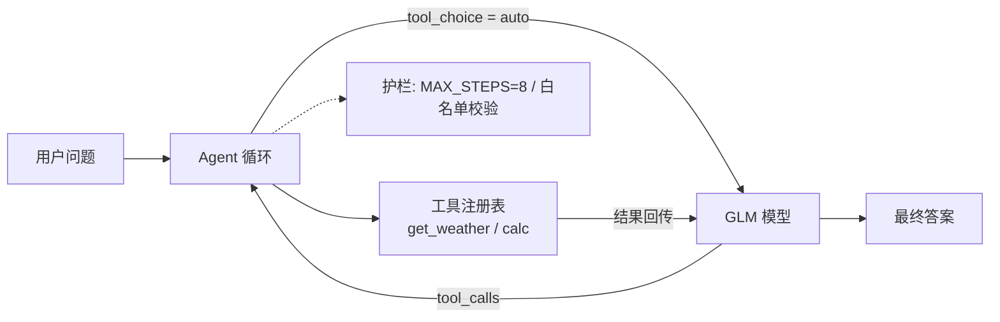

# glm-agent-demo — 最小 AI 应用参考实现（Agent / RAG / Eval）

> 一个解决方案架构师的"最小可运行"参考实现：用智谱 GLM API 演示企业级
> AI 应用的三个核心构件——**工具调用 Agent、带引用的 RAG、自动化评测**。
> 全部单文件、零框架、可读可改。

## 背景

作者在腾讯云智能体开发平台（ADP）交付企业级 AI 应用（媒体/能源/电网/民航
行业，30+ 项目，最近一个项目从启动到上线交付 6 天）。本仓库把这些实战中
反复验证的模式，收敛成三个最小实现——生产中用平台，原理上用单文件讲透：

| 构件 | 文件 | 对应的生产问题 |
|------|------|----------------|
| Agent 推理循环 | `agent_demo.py` | 工具注册表、循环防失控、错误自纠 |
| 带引用的 RAG | `rag_demo.py` | 幻觉治理：检索 grounding + 强制引用 + 拒答约束 |
| 评测集 | `eval_agent.py` | 用例即断言，行为断言优于字面断言，可接 CI |

## 架构



## 快速开始

```bash
pip install openai numpy
export ZHIPUAI_API_KEY="你的key"   # open.bigmodel.cn 免费申请

python agent_demo.py "北京和上海今天的气温差多少度？"   # Agent：模型自主调工具
python rag_demo.py "出差住宿标准是多少？"               # RAG：带引用与拒答约束
python eval_agent.py                                    # 评测：输出通过率报告
```

## 设计决策（面试常问）

- **为什么不用 LangChain？** 单文件实现更能暴露原理；框架是加速器不是
  遮羞布。注册表模式 30 行就能讲清楚 Agent 循环的本质。
- **为什么 MAX_STEPS=8？** 防止工具调用循环失控。生产环境还需加：单步
  超时、累计成本护栏、敏感工具人工确认。
- **为什么 RAG 强制引用 + 拒答？** 幻觉无法归零，只能可管理——"无法引用
  就承认不知道"是产品级承诺，也是对用户信任的最低成本保护。
- **为什么评测断言"行为"而非"字面"？** LLM 输出非确定性，断言"是否调用
  了正确的工具"比断言答案原文稳健得多——这是评测体系设计的第一原则。

## 生产验证

这些模式来自真实交付：某省级广播电台健康问答数字员工（60 期节目音频
全量结构化入库、五维度 17 用例评测全通过、首响 3.4s），其中"确定性代码
优于提示词约束""双保险架构"等原则直接沉淀自产线攻坚。

## Roadmap

- [ ] 工具协议对齐 MCP（Model Context Protocol）
- [ ] 子智能体编排（planner-executor 模式）
- [ ] 接入真实数据源与文档解析场景
